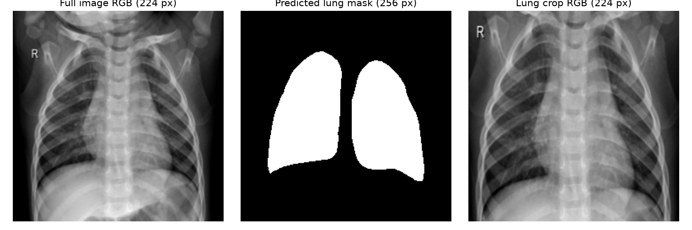
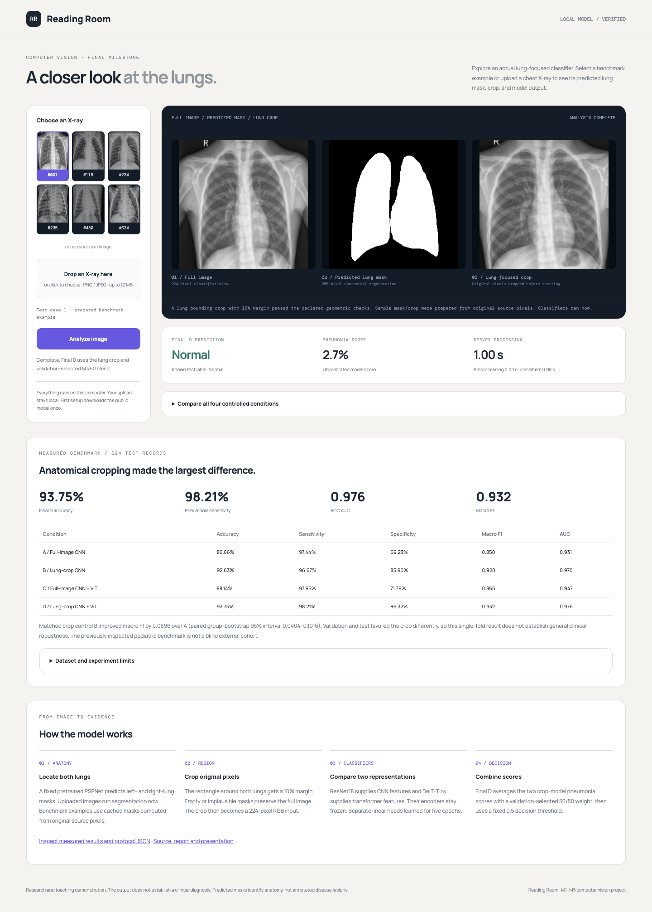

<p align="center"></p>

<p align="center"><strong>A runnable lung-focused pneumonia research demo, with a complete experiment history.</strong></p>
<p align="center">CPU inference · PyTorch · FastAPI · Local model weights · Four verified comparisons</p>

<p align="center"><a href="START_HERE.md"><strong>Presenting tomorrow? Start here</strong></a> · <a href="https://github.com/HulkInTherapy/reading-room-pneumonia/releases/tag/v1.0.0">Download files</a> · <a href="docs/Research_Report.pdf">Research report</a> · <a href="docs/Presenter_Notes.md">What to say</a></p>

## The quickest presentation path

**Open the [Presenter Hub](https://hulkintherapy.github.io/reading-room-pneumonia/)** for the slides, script, recorded demo and live-setup guide.

**No Python or coding required:** download **[Presentation_Kit.zip](https://github.com/HulkInTherapy/reading-room-pneumonia/releases/download/v1.0.0/Presentation_Kit.zip)**, extract it, and open **Presentation_8_Slides.pdf**. Read **Presenter_Notes.md** once. The kit also contains **Offline_Demo.html**, a clearly labelled recording of actual model responses that works without a network connection.

| File                                                       | Use it for                                                         |
| ---------------------------------------------------------- | ------------------------------------------------------------------ |
| [Eight-slide presentation](docs/Presentation_8_Slides.pdf) | Minimal, visual slides for a 5–7 minute talk                       |
| [HTML slideshow](docs/Presentation_8_Slides.html)          | Offline fullscreen slides; use arrow keys                          |
| [Presenter script and Q&A](docs/Presenter_Notes.pdf)       | Simple explanations for presenters who are new to the project      |
| [IEEE-format research report](docs/Research_Report.pdf)    | Full history, settings, graphs, errors, limitations and references |
| [LaTeX report source](docs/Research_Report.tex)            | Editable source using the actual `IEEEtran` conference class       |
| [Start-here guide](START_HERE.md)                          | Exact demo steps and recovery instructions                         |

## Run the live model

1. Install **Python 3.13**, the tested runtime.
2. Download this repository with **Code → Download ZIP** and extract it, or clone it:

   ```bash
   git clone https://github.com/HulkInTherapy/reading-room-pneumonia.git
   cd reading-room-pneumonia
   ```

3. Double-click **Start_Windows.bat** on Windows or **Start_Mac.command** on Mac. For Linux, or a terminal launch:

   ```bash
   python3.13 setup_demo.py
   ```

   Windows terminal alternative:

   ```powershell
   py -3.13 setup_demo.py
   ```

4. Wait for setup to finish. The browser opens at the local address printed in the terminal, normally `http://127.0.0.1:8765`. Keep that terminal open.
5. Select a supplied X-ray and click **Analyze image**. The page shows the full image, predicted lung mask, crop and final prediction. Optional controls expose all four model conditions.

**First setup needs an internet connection.** It creates a private environment, installs CPU libraries, downloads the **326 MiB** model release and verifies its SHA-256 and individual file hashes. Later launches reuse it. Allow time for this before presenting. The first prediction can be slower while Python libraries and weights load.

No GPU, API key, SSH key, VPS account or GitHub login is needed. Linux CPU execution was tested. Mac and Windows launcher scripts are provided, but those operating systems were not tested in this project. If setup fails, rerun the same launcher after checking the connection; the offline presentation kit is always available as a backup.

<details><summary><strong>Already have the portable model ZIP?</strong></summary>

You can avoid downloading it again:

```bash
python3.13 scripts/download_models.py --archive /path/to/Portable_Lung_Model.zip
```

The script verifies and safely extracts it into the ignored `models/` folder. To verify installed model files:

```bash
python3.13 scripts/download_models.py --verify-only
```

After dependencies are installed:

```bash
.venv/bin/python launch.py
```

On Windows the interpreter is `.venv\Scripts\python.exe`. `launch.py` chooses a free local port automatically.

</details>

## What the demo actually does

<p align="center"></p>

An uploaded image passes through a fixed pretrained anatomical segmenter. A bounding rectangle around both predicted lungs receives a 10% margin and is cropped from the original pixels. ResNet18 and DeiT-Tiny encode that crop, and their trained classifier probabilities are combined equally for final condition D.

The supplied samples already have masks and crops prepared from their original-resolution sources; **classification still runs live**. Uploaded images run segmentation as well. Empty or geometrically implausible masks use the full-image fallback. A mask predicts anatomy, not pneumonia lesions. Scores are uncalibrated model outputs.

<p align="center"></p>

## Measured results

All four final conditions use the same saved split and five-epoch classifier-head protocol.

| Condition | Input and classifier         |   Accuracy | Pneumonia recall | Specificity |   Macro F1 |        AUC |
| --------- | ---------------------------- | ---------: | ---------------: | ----------: | ---------: | ---------: |
| A         | Full image, ResNet18         |     86.86% |           97.44% |      69.23% |     0.8503 |     0.9308 |
| B         | Lung crop, ResNet18          |     92.63% |           96.67% |      85.90% |     0.9199 |     0.9703 |
| C         | Full image, CNN/ViT blend    |     88.14% |           97.95% |      71.79% |     0.8656 |     0.9472 |
| **D**     | **Lung crop, CNN/ViT blend** | **93.75%** |       **98.21%** |  **86.32%** | **0.9318** | **0.9757** |

D correctly classifies **585/624** test records, detects **383/390** pneumonia records, and makes **32 false alarms and seven missed pneumonia predictions**. ViT weights were selected on validation: 0.25 for C and 0.50 for D.

The matched crop effect B minus A is **+0.0696 macro F1**, with paired proxy-group bootstrap 95% interval **[0.0404, 0.1016]**. On 618 unique test images, D accuracy is 93.69%.

**Important interpretation:** cropping lowered validation macro F1 while improving test macro F1. We report that reversal prominently. This is one frozen-encoder, single-seed pilot on a previously inspected pediatric benchmark. It does not establish universal improvement or clinical readiness. The larger originally proposed five-CNN crop ablation was reduced to a single-CNN pilot for the available CPU budget.

## The complete research history

| Stage        | What changed                                                                     |            Test accuracy |
| ------------ | -------------------------------------------------------------------------------- | -----------------------: |
| M1           | Literature review and initial crop idea                                          |          No model result |
| Initial M2   | Five CNNs, five epochs, cached prefix features and fixed views                   |                   87.18% |
| M2 audit     | 15 epochs, revised split/views, validation checkpoints                           |                   85.74% |
| Corrected M2 | Five fixed online epochs, fresh augmentation, FP32, adapted BatchNorm statistics |                   92.15% |
| M3           | Timestamped crop + small-transformer hypothesis                                  | Prediction, not a result |
| M4–M5        | Four controlled frozen-feature conditions, failure analysis and demo             |                D: 93.75% |

Historical runs changed multiple settings, so their differences are descriptive. Use A/B/C/D to isolate the final interventions. The base paper reports 96.39% accuracy under a longer and different protocol; we do not claim to beat it.

The full [report](docs/Research_Report.pdf) explains what failed, what was corrected, what remains deferred, and why the final score must be interpreted carefully. Historical M1 material includes superseded statements and is explicitly archived.

## Find your way around

```text
app.py                    Standalone live inference API
web/                      Main HTML, local fonts and recorded offline backup
samples/                  Six public prepared examples + measured benchmark table
setup_demo.py             One-time CPU environment and model setup
launch.py                 Start the local server and browser
scripts/                  Verified downloader and audit helpers
docs/                     Final report, eight slides, speaker notes and figures
research/m2_m3/           Original baseline code, audits, results and notebooks
research/m4_m5/           Final experiment code, results, predictions and notebooks
research/archive/        Earlier literature/presentation material with corrections
model_release.json        Versioned model URL, size and exact SHA-256
models/                   Downloaded weights (created by setup; excluded from Git)
```

Large weights are hosted in **[GitHub Releases](https://github.com/HulkInTherapy/reading-room-pneumonia/releases/tag/v1.0.0)** rather than regular Git history:

- **Portable_Lung_Model.zip:** complete latest model, encoders, segmenter, heads, examples and manifest.
- **Historical_Models.zip:** saved final/selected checkpoints from the three baseline experiments.
- **Presentation_Kit.zip:** eight-slide talk, script, report and offline demo.

Raw training images, environments, redundant optimizer-resume states and activation caches are regenerated from the documented sources rather than committed. No credentials are required by the live demonstration.

## Team

| Author           | Student ID |
| ---------------- | ---------- |
| Samarth Shekhar  | 230042     |
| Meghavi Rao      | 230044     |
| Rachit Kumar     | 230128     |
| Harshal Nerpagar | 230076     |

## Reproduce and verify

The historical and final notebooks, per-image CSVs, checkpoint hashes, splits and source audit are in `research/`. The report explains the distinct protocols. Reproducing training downloads the source shards and takes substantially longer than launching the demo; presenters do not need to retrain anything.

For a dependency-free recomputation of the final benchmark metrics:

```bash
python3.13 scripts/verify_benchmark.py
```

Runtime/model versions and original inference checks are retained with the research artifacts. To rebuild the report figures, install the scientific plotting dependencies and run `docs/build_figures.py`; compile `docs/Research_Report.tex` with `pdflatex` twice. `docs/build_slides.py` rebuilds the eight-slide PDF/HTML after figures exist.

Data and pretrained models retain their original terms. See [THIRD_PARTY_NOTICES.md](THIRD_PARTY_NOTICES.md) for source attribution.

<p align="center"></p>
