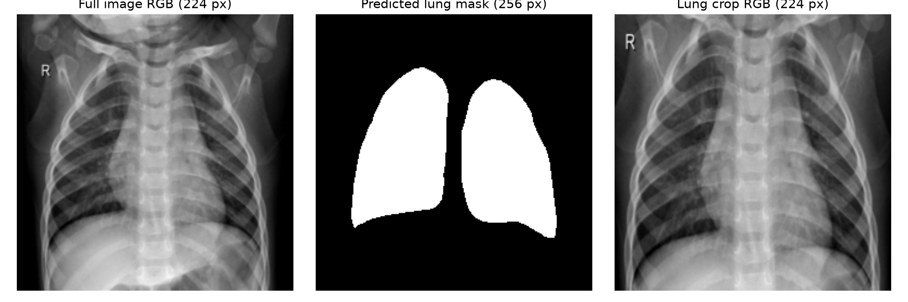

# Reading Room — understand the whole project in 20 minutes

For the presenter: you do not need to understand the Python code. Read this file once, then spend the last few minutes saying the story aloud and trying one demo image. Everything below describes what we actually did.

**Our team:** Samarth Shekhar, Meghavi Rao, Rachit Kumar and Harshal Nerpagar.

## 1. The whole project in one minute

We give the computer a child's chest X-ray. It predicts one of two labels: **Normal** or **Pneumonia**.

We first built a starting system based on a published research paper. Then we tested an idea: perhaps the computer can classify the image better if we give it a closer view of the lungs instead of the entire X-ray. We also added a second kind of image model and checked whether combining its opinion with the CNN helped.

Our final model correctly classified **585 of 624 test images**, which is **93.75% accuracy**. It found **383 of 390 pneumonia-labelled images**, which is **98.21% pneumonia recall**. It still made mistakes: **32 false alarms and seven missed pneumonia cases**.

The project includes real trained classifier heads, saved model weights, numerical comparisons, mistake analysis and a working web demonstration. The result is limited to a public research benchmark. We have not established performance in real clinical use.

**A simple opening:** “Our project studies whether focusing a computer vision model on the lungs improves normal-versus-pneumonia classification from pediatric chest X-rays.”

## 2. What exactly was the dataset? About two minutes

We used the **public Kermany pediatric chest X-ray dataset (2018)**, commonly called **Chest X-Ray Images (Pneumonia)**. The images originated from Guangzhou Women and Children's Medical Center. We accessed the recorded public Hugging Face mirror, rather than collecting patients ourselves.

There are two labels in our task:

- **Normal:** the dataset labels the image as normal.
- **Pneumonia:** the dataset labels the image as pneumonia. We do not separately predict bacterial versus viral pneumonia.

The original collection has **5,856 image records**: 5,216 training, 16 original validation and 624 test records. For the paper-style baseline, the small original validation set was combined with training, giving 5,232 training records.

For the final controlled experiment, we used the audited deduplication and grouping scheme. The non-test pool was deduplicated to 5,206 records before splitting. It produced **4,164 training records, 1,042 validation records and the original 624 test records**. The test set has **234 normal and 390 pneumonia records**. Its unique-image check contains 618 images because six test records repeat images.

The three jobs are different: **training** teaches the model, **validation** helps choose settings, and **test** measures the chosen system. Think of them as practice, a mock exam and an evaluation. Our test set had been viewed in earlier project work, so do not call it a completely unseen external hospital test.

We used filename groups as imperfect patient proxies. That is more careful than ignoring grouping, but it does not prove exact patient independence. The data come from one pediatric center, so the result does not automatically apply to adults or other hospitals.

**What to say on slide 2:** “We use the public Kermany pediatric X-ray dataset with two labels. Our final split has 4,164 training, 1,042 validation and 624 test records.”

## 3. The model names, without complicated mathematics

**A pretrained model** already learned useful visual patterns from a large image collection. We reuse those patterns instead of learning everything from nothing.

**A CNN** is an image model that builds features from local regions. **ResNet18** is the CNN used in our final pilot.

**A vision transformer, or ViT,** treats an image as patches and relates those patches using attention. Our transformer is **DeiT-Tiny**. It may make different errors from the CNN, which is why combining them can help. Combining models is useful only if the measurements actually improve.

**A classifier head** is the small final decision stage. In the final pilot we kept the large image encoders fixed and trained four small heads for **five epochs each**. An epoch is one pass through the training examples. We did not train the entire CNN or transformer from scratch.

**PSPNet** is a separate, fixed pretrained anatomical model supplied through TorchXRayVision. It estimates the lungs. It is not our pneumonia classifier. The complete pipeline therefore uses a lung segmenter plus the two image readers.

Earlier, our reference system used **five CNNs: AlexNet, DenseNet121, GoogLeNet, InceptionV3 and ResNet18**. Each voted for a class, and a majority decided. The final experiment is a smaller ResNet18/DeiT-Tiny pilot, not the full five-CNN crop experiment originally proposed.

**Remember:** old reference = five CNNs voting; new pilot = lung crop plus a CNN and a transformer, with their scores combined.

## 4. Our journey from M1 to M5. About three minutes

A **baseline** is the starting method used for comparison. A **hypothesis** is a prediction written before running the improvement experiment.

| Stage             | What we did                                                                                                   | Measured result                                                    |
| ----------------- | ------------------------------------------------------------------------------------------------------------- | ------------------------------------------------------------------ |
| M1                | Reviewed earlier studies and planned a lung-focused improvement.                                              | No trained-model result yet.                                       |
| M2, first attempt | Reconstructed the five-CNN baseline with cached image features and five training epochs.                      | 87.18% accuracy.                                                   |
| M2, longer audit  | Tried 15 epochs with a revised split and saved image views; investigated the gap between validation and test. | 85.74% accuracy.                                                   |
| M2, corrected run | Used fresh image augmentation, complete FP32 image forwards and corrected training behavior for five epochs.  | 92.15% accuracy.                                                   |
| M3                | Recorded the crop and small-transformer proposal and numerical predictions before implementing them.          | These were predictions, not measured gains.                        |
| M4                | Prepared original-pixel lung crops and ran four matched comparisons.                                          | Final condition D: 93.75% accuracy.                                |
| M5                | Analyzed wrong predictions, mask failures, uncertainty and limitations; verified and packaged the demo.       | The same measured D result, with evidence and a working interface. |

**Why did 15 epochs do worse?** Several settings changed together. We cannot conclude that more epochs always hurt. We audited the implementation rather than hiding the low score. The corrected online run removed earlier approximations and improved the score, but it changed several things at once, so it is not proof that one correction alone caused the gain.

**What is augmentation?** It means creating small training variations, such as changing brightness or flipping an image. The corrected M2 baseline already used fresh augmentation. The final frozen-feature pilot does not use fresh online augmentation, so do not present augmentation as a newly measured M4 improvement.

The historical runs are our learning story. The fair comparison of the final changes is A/B/C/D, explained next.

## 5. What did lung-focused cropping actually do? About three minutes

Look at the three-image pipeline on slide 4.

**First: full image.** A full X-ray contains lungs and surrounding anatomy. It may also include borders and side markers. Our classifier has a fixed input size, so a full-image resize spends some of those pixels outside the lungs.

**Second: predicted lung mask.** The anatomical model estimates which pixels belong to the left and right lungs. White areas mean “predicted lung,” not “pneumonia.” We do not have manual lung masks here, so we cannot claim a measured segmentation accuracy or perfect boundaries.

**Third: lung crop RGB.** We take a rectangle around both estimated lungs, add a 10% margin on each side and crop the original-resolution image. Only after cropping do we resize to **224 × 224** for classification. The idea is to devote more of the fixed input to lung tissue. “RGB” means the three-channel image format expected by the networks; it does not mean we painted medical colors onto a grayscale X-ray.

The rectangle can still include the heart and side markers. It does not remove every possible shortcut. Bad cropping can also remove useful information, which is why we needed a full-image control.

The segmenter normally uses a 512-pixel input. On our CPU it was too slow for the complete dataset, so the final run used a documented **256-pixel segmentation input**. The crop was still mapped onto original source pixels. We processed **5,824 unique source images**.

If a mask is empty or implausibly small/large, the pipeline keeps the full image. This automatic fallback happened for **82 images, or 1.41%**. That is the rate of automatic flags, not the true error rate of segmentation.

**One sentence to say:** “The mask estimates the lungs, the crop gives them more of the input, and the classifiers make the normal-or-pneumonia decision.”

## 6. What did we compare, and why is it fair?

We changed two factors: full image versus crop, and CNN alone versus CNN plus transformer. We used the same split and comparable five-epoch head training across all four conditions.

| Run | What the model receives | What predicts the label           | Accuracy |
| --- | ----------------------- | --------------------------------- | -------- |
| A   | Full X-ray              | ResNet18 CNN                      | 86.86%   |
| B   | Lung crop               | ResNet18 CNN                      | 92.63%   |
| C   | Full X-ray              | CNN and DeiT-Tiny scores combined | 88.14%   |
| D   | Lung crop               | CNN and DeiT-Tiny scores combined | 93.75%   |

**B versus A** tests cropping: the classifier type stays the same. **C versus A** tests adding the transformer on full images. **D versus B** tests adding it to crops. D is the final crop-plus-transformer condition proposed before implementation.

For D, the CNN and transformer each get a **50% weight** in the final pneumonia score. For C, the transformer gets 25% and the CNN 75%. These weights were chosen using validation macro F1, not by selecting the nicest test score. We use a fixed 0.5 decision threshold.

Cropping raised the matched CNN accuracy from 86.86% to 92.63%. Adding the transformer to the crop model raised it to 93.75%. Combined D versus A is **+6.89 percentage points**.

That 6.89-point gain is against the **new matched control A**, not against our previous 92.15% ensemble. Against the previous final ensemble, the numerical gain is 1.60 points. Those historical methods differ, so that difference alone cannot isolate cropping.

## 7. Understand the results and mistakes. About three minutes

**Accuracy: 93.75%.** The model correctly classified 585 of all 624 test records.

**Pneumonia recall: 98.21%.** It found 383 of the 390 pneumonia-labelled records and missed seven. Recall asks, “Of all pneumonia cases, how many did we find?”

**Specificity: 86.32%.** It correctly recognized 202 of 234 normal-labelled records. The remaining 32 were false alarms. Specificity asks, “Of all normal cases, how many did we recognize?”

**A false alarm** is a normal-labelled image predicted as pneumonia. **A missed case** is a pneumonia-labelled image predicted as normal. The two pictures on slide 7 are actual examples of those errors. We do not know a medically verified reason for each error just by looking at the picture.

Our previous ensemble made 49 errors: 28 false alarms and 21 missed pneumonia cases. The new model makes 39: 32 false alarms and seven missed cases. It misses fewer pneumonia cases but produces slightly more false alarms.

**Macro F1 is 0.9318.** It gives the normal and pneumonia class F1 scores equal weight, so poor normal-case performance is harder to hide. **AUC is 0.9757.** It measures how well scores rank the two classes over thresholds. You do not need to explain the formula during the talk.

**The main limitation:** cropping improved the benchmark test result but reduced validation macro F1. We do not know why from one split. It means the effect is not established as reliable across all partitions or hospitals. The report includes this reversal rather than removing it.

Other limits are one training seed, imperfect filename patient groups, a previously inspected test set and one pediatric source center. A nice-looking mask or a high individual score does not prove medical correctness.

**What can improve next?** Repeat group-aware splits and seeds, test another independent dataset, inspect difficult masks, and evaluate limited backbone fine-tuning. These are next experiments, not gains already achieved.

## 8. What we completed this term and in the latest delivery

The model work added original-pixel lung cropping, a separate transformer, matched comparisons, automatic fallbacks, error analysis and numerical verification. The final pilot used the existing isolated CPU VPS; we did not need to train on this Mac or a GPU.

The delivery work made the model easier to present: a standalone web app, six sample images, real upload inference, local model loading, checksummed public model downloads, Mac/Windows launchers, a public presenter hub, an offline recorded backup, a full IEEE-format report and a readable 8-slide talk.

We checked the calculations, saved models and live outputs, and tested a fresh public GitHub download. **These revised notes and slides explain the same trained model; they do not retrain it.**

## 9. The last three minutes: rehearse and try the demo

Say this summary aloud:

> “We classify public pediatric chest X-rays as normal or pneumonia. We first reconstructed a five-CNN baseline, then tested lung cropping and a small transformer with four matched comparisons. Our final model reached 93.75% accuracy and 98.21% pneumonia recall on 624 test records. We also show actual mistakes and the validation/test limitation.”

For the demo:

1. Open the presenter hub: https://hulkintherapy.github.io/reading-room-pneumonia/
2. If the live model is already set up, use its local browser page. Select a sample and click **Analyze image**.
3. Point to **full image → predicted mask → crop → final result**.
4. For built-in samples the mask/crop is prepared, but classifier inference runs now. Uploads run segmentation too.
5. If setup or connectivity fails, open **Offline_Demo.html** from the kit. Say explicitly that it contains recorded actual model responses.

First live setup requires Python 3.13, CPU libraries and the one-time 326 MiB model download. Do this before leaving home. After setup, model inference uses local weights and needs no API key, SSH access or GitHub login.

## 10. Five questions you should be ready for

**Did you train everything from scratch?** No. We reused pretrained encoders and a fixed pretrained segmenter. The final pilot trained four small classifier heads for five epochs each. Earlier baseline work trained specified late CNN layers too.

**Did you beat the reference paper?** No. Chouhan's paper reports 96.39% accuracy; we report 93.75% under a shorter and different protocol. Other papers also report higher scores with different evaluations. We do not claim to be best in industry.

**Does the white mask show the infection?** No. It is the estimated anatomical lung region. It is not a disease annotation.

**Why did validation and test disagree?** We cannot establish the cause from this one split. It is an important reason to repeat the experiment on more partitions and external data.

**What is the main achievement?** We moved from a working reproduction to a measured, explainable and runnable research pipeline, with real controls, preserved failures and verified artifacts.

**If you forget a technical detail:** say, “The exact setting is in our report; I do not want to guess.” The strongest presentation is accurate and clear, not full of memorized jargon.
